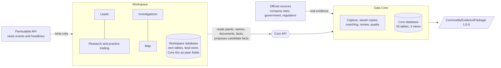

# Architecture

Since DC1 (October 2026) the platform is two projects with one connection ([the split note](SPLIT.md)). This repository
is the **Workspace**; the **Data Core** is the source of truth for plant, source and fact data.

## The two parts

The Workspace knows the Core; the Core does not know the Workspace. The Workspace never touches the Core database,
stores Core IDs instead of copies, and sends candidate facts that the Core checks before accepting them
([CONTRACT.md](CONTRACT.md)). Permutable material stays in the Workspace.

## Workspace components

FastAPI with a same-origin static interface, SQLAlchemy and one straight Alembic migration line. PostgreSQL is the
deployment database; SQLite supports local use and tests. `app/core_client.py` is the only way to Core data; each
request uses one cached view, so a Core list is read once per request.

- **Leads** (`app/permutable.py`, `app/acquisition.py`): licensed lead-feed capture with audited access decisions,
  credentials bound to approved hosts, pinned public addresses, retries, attempt logs and exact saved copies, into the
  Workspace's lead store; a versioned parser derives leads, revisions and headlines and matches event text against
  current Core plant names. Replay proves stored lead facts equal the saved responses.
- **Research and practice trading** (`app/research.py`): event chains over Core plants and the ownership and operator
  links the Core had recorded by the time an event became known; a cash-only paper ledger.
- **Investigations** (`app/investigations.py`) and **the map** (`app/asset_map.py`): analyst records that cite Core
  documents and plants.
- **Trader assistant** (`app/chatbot.py`): bounded retrieval over Workspace records and Core facts.

## Data diagram

Workspace tables. Dashed links are Core references: plain fields holding Data Core IDs, checked through the API.

```mermaid
erDiagram
  LEAD_SOURCE ||--o{ LEAD_SOURCE_ACCESS : governs
  LEAD_SOURCE ||--o{ LEAD_DOCUMENT : publishes
  LEAD_SOURCE ||--o{ LEAD_SOURCE_DOCUMENT : relates
  LEAD_DOCUMENT ||--o{ LEAD_SOURCE_DOCUMENT : relates
  LEAD_DOCUMENT ||--o| LEAD_DOCUMENT_VERSION : versions
  LEAD_SNAPSHOT ||--o{ LEAD_DOCUMENT_VERSION : preserves
  LEAD_RUN ||--o{ LEAD_RETRIEVAL_ATTEMPT : logs
  LEAD_SOURCE ||--o{ LEAD : feeds
  LEAD ||--o{ LEAD_REVISION : revisions
  LEAD ||--o{ LEAD_HEADLINE : headlines
  LEAD_DOCUMENT ||--o{ LEAD_REVISION : carries
  LEAD_DOCUMENT ||--o{ LEAD_HEADLINE : carries
  RESEARCH_EVENT ||--o| RESEARCH_OUTCOME : labels
  RESEARCH_QUOTE ||--o{ RESEARCH_OUTCOME : prices
  PAPER_POLICY ||--o{ RESEARCH_PAPER_ACCOUNT : configures
  RESEARCH_EVENT ||--o| RESEARCH_PAPER_DECISION : decides
  INVESTIGATION ||--o{ INVESTIGATION_REVISION : history
  INVESTIGATION ||--o{ INVESTIGATION_ENTRY : notebook
  INVESTIGATION ||--o{ INVESTIGATION_TASK : tasks
  INVESTIGATION_TASK ||--o{ INVESTIGATION_TASK_EVIDENCE : cites
  INVESTIGATION_ENTRY ||--o{ INVESTIGATION_TASK_EVIDENCE : cited_by
  CORE_DOCUMENT ||..o{ LEAD : "confirms (primary_document_id)"
  CORE_OBSERVATION ||..o{ LEAD : "supports (observation_id)"
  CORE_DOCUMENT ||..o{ INVESTIGATION_ENTRY : "evidence (document_id)"
  CORE_ENTITY ||..o{ ASSET_LOCATION : "placed (entity_id)"
  CORE_DOCUMENT ||..o{ ASSET_LOCATION : "supports (document_id)"
  CORE_ENTITY ||..o{ ASSET_DEPENDENCY : "from / to"
  CORE_DOCUMENT ||..o{ ASSET_DEPENDENCY : "supports (document_id)"
```

Also in the Workspace database: `audit` (the Workspace's change history) and the old trading screens' tables
`market_observations`, `paper_accounts` and `paper_orders`. Research events and lead revisions keep Core plant IDs in
JSON fields. The Core's own tables and views are drawn in its repository (`docs/DATA_DIAGRAM.md`).

## Integrity

Database constraints and foreign keys hold within the Workspace; Core references are checked through the API on
write and kept unchanged afterwards. Lead-feed responses are content-addressed and verified on every read. Writes need
a Workspace credential (`WRITE_TOKEN` or `WRITE_IDENTITIES_JSON`); reads can be protected with `REQUIRE_READ_AUTH`.

## Deployment

Docker runs a non-root application, a migration job, a private PostgreSQL and a loopback port, alone
(`compose.yaml`, using a Core elsewhere) or together with the Core (`compose.together.yaml`). Each part needs its own
coordinated database and snapshot backups ([RUNBOOK.md](RUNBOOK.md)). Enable read protection and TLS/private ingress
before shared use.
